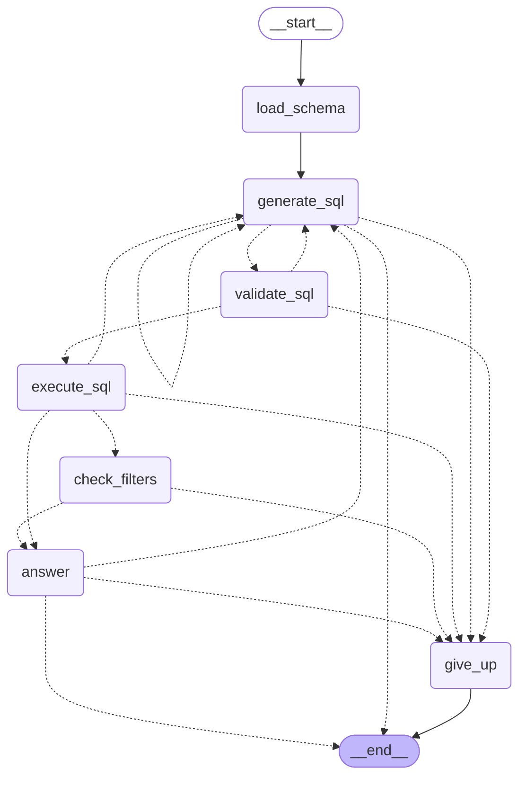

# University QA Agent

Ask a question in plain English about a SQL database and get an answer, the SQL that produced it,
and a full trace of how the system got there. Built with LangGraph. The demo database describes a
university, but the agent contains no knowledge of it: the schema is read from the database at
run time.

```text
$ uv run sqlqa ask "What is Daniel Kim's average grade?"

There are two students named Daniel Kim, told apart by email. daniel.kim@uni.example (id 4) has an average grade of 62.5. daniel.kim2@uni.example (id 6) has an average grade of about 91.33. In-progress enrollments with no grade yet were left out of each average.

Query 1: SELECT s.id, s.name, s.email, AVG(e.grade) AS average_grade FROM students s JOIN enrollments e ON e.student_id = s.id WHERE s.name = 'Daniel Kim' COLLATE NOCASE GROUP BY s.id, s.name, s.email
Status: answered
Trace:  traces\<run id>.json
```

This is the output of the run committed as [`docs/traces/02-duplicate-names.md`](docs/traces/02-duplicate-names.md).

## Quick start

Requires [uv](https://docs.astral.sh/uv/) and an API key for a model provider.

```bash
uv sync                                  # install (Python 3.13 is fetched if needed)
cp .env.example .env                     # then put your API key in .env
uv run python -m university.build_db     # create the demo SQLite database

uv run sqlqa ask "Which teacher has the highest average grade?"
uv run sqlqa render-trace traces/<run>.json     # the trace as readable Markdown
```

## How it works



This diagram is the output of LangGraph's `draw_mermaid()` on the compiled graph.

| Node | Calls the model? | What it does |
| --- | --- | --- |
| `load_schema` | no | Reads tables, columns, keys and a few sample rows from the live database. |
| `generate_sql` | yes | Writes one SELECT with a short plan, or asks a clarifying question, or says the database cannot answer. |
| `validate_sql` | no | Rejects anything that is not a single read-only SELECT over known tables. |
| `execute_sql` | no | Runs the query on a read-only connection with a row limit. |
| `check_filters` | no | Only after an empty result: asks the database whether the query's filter values exist, and which values do. |
| `answer` | yes | Writes the answer from the rows, or asks for one more query and says why. |
| `give_up` | no | Ends with an honest failure message when a limit is reached. |

The straight path is `load_schema → generate_sql → validate_sql → execute_sql → answer`, which
costs two model calls. When a query returns nothing, `check_filters` runs before `answer` and
gives it evidence: whether each filter value exists, and if not, what does. It makes no model
call. Three things send a run back to `generate_sql`, each with its own limit:

| Loop | Trigger | Limit |
| --- | --- | --- |
| Repair | The guard or the database rejects the SQL; the error is sent back to the model. | 3 attempts per query |
| Multi-step | `answer` needs data the first query did not fetch, or got an empty result it does not trust. | 3 queries per question |
| Overall | Any of the above. | 10 model calls per run |

The reasoning behind each choice is in [docs/DESIGN.md](docs/DESIGN.md).

## Where each requirement is met

| Requirement | Where |
| --- | --- |
| Database design | [`university/schema.sql`](university/schema.sql), [`university/seed.sql`](university/seed.sql) |
| LangGraph agent | [`src/sqlqa/graph.py`](src/sqlqa/graph.py), [`src/sqlqa/nodes.py`](src/sqlqa/nodes.py), [`src/sqlqa/prompts.py`](src/sqlqa/prompts.py) |
| Database-agnostic design | [`src/sqlqa/db.py`](src/sqlqa/db.py) introspects the schema; everything university-specific is in [`university/`](university/) |
| Tracing | [`src/sqlqa/tracing.py`](src/sqlqa/tracing.py), example traces in [`docs/traces/`](docs/traces/) |
| Debugging and error handling | [`src/sqlqa/sql_guard.py`](src/sqlqa/sql_guard.py), [`src/sqlqa/filter_check.py`](src/sqlqa/filter_check.py), the loops above, and the walkthrough in [docs/EXAMPLES.md](docs/EXAMPLES.md#debugging-a-wrong-answer) |
| Unit tests | [`tests/`](tests/): 169 offline tests, plus 16 live evaluation questions |
| Code quality | One responsibility per module; see the layout below |
| Production considerations | [docs/PRODUCTION.md](docs/PRODUCTION.md) |
| Example queries and outputs | [docs/EXAMPLES.md](docs/EXAMPLES.md) |

## Project layout

```text
src/sqlqa/            the agent; knows nothing about universities
  config.py           settings from environment variables
  db.py               read-only engine, schema introspection, query execution
  sql_guard.py        the SELECT-only check (sqlglot)
  filter_check.py     after an empty result: do the query's filter values exist?
  llm.py              model creation, output shapes, the one function that calls the model
  prompts.py          prompt text with placeholders
  state.py            the state that flows through the graph
  nodes.py            one method per node
  graph.py            wiring, routing and limits
  tracing.py          JSON trace and Markdown view
  cli.py              the sqlqa command
university/           the demo database: schema, seed data, notes, golden questions
tests/                offline tests with a scripted model; one live evaluation file
docs/                 design, production notes, examples, committed traces
scripts/              make_examples.py regenerates docs/traces/ and docs/EXAMPLES.md
```

## Tests

```bash
uv run pytest             # 169 tests, offline, about 2 seconds, no API key needed
uv run pytest -m live     # 16 real questions against the real model (costs a few cents)
uv run ruff check .
```

GitHub Actions runs the lint and the offline tests on every pull request and on `main`
([`.github/workflows/ci.yml`](.github/workflows/ci.yml)). The live evaluation is not run there,
because it needs an API key and costs money.

The offline tests use a scripted stand-in for the model (`tests/fakes.py`), so they test the graph,
the guard, the database layer and the tracer exactly, and say nothing about how well a real model
writes SQL. The live evaluation covers that: each question in
[`university/golden_questions.json`](university/golden_questions.json) lists values that a correct
run must have fetched from the database.

## Tracing

Every run writes one JSON file to `traces/` with every node, every prompt and reply, the SQL, the
guard's verdict, every returned row, timings and token counts. `sqlqa render-trace` turns it into
Markdown. Eleven example traces, in both forms, are in [`docs/traces/`](docs/traces/).

LangSmith works as well, with no code change: set `LANGSMITH_TRACING=true`, `LANGSMITH_API_KEY`
and `LANGSMITH_PROJECT` in `.env`.

## Using a different database or model

- **Database:** set `DATABASE_URL` to any SQLAlchemy URL. Optionally point `SCHEMA_NOTES_FILE` at a
  short text file that explains what the data means. No code changes. Only SQLite has been run
  here; see the trade-off in [docs/DESIGN.md](docs/DESIGN.md).
- **Model:** set `LLM_MODEL` to `provider:model` and install that provider's langchain package.

All settings are documented in [`.env.example`](.env.example).

## AI usage

The implementation was done with Claude Code, directed phase by phase: each phase started with a
batch of design questions, and each ended with a review of the tests and a pull request.
[`CLAUDE.md`](CLAUDE.md) holds the constraints and conventions that were set for it. The full
session history is in [`ai-session-history/`](ai-session-history/).

## Documentation

- [docs/DESIGN.md](docs/DESIGN.md): design decisions, trade-offs and assumptions
- [docs/EXAMPLES.md](docs/EXAMPLES.md): example questions with answers and traces, and a debugging walkthrough
- [docs/PRODUCTION.md](docs/PRODUCTION.md): what it would take to run this in production
